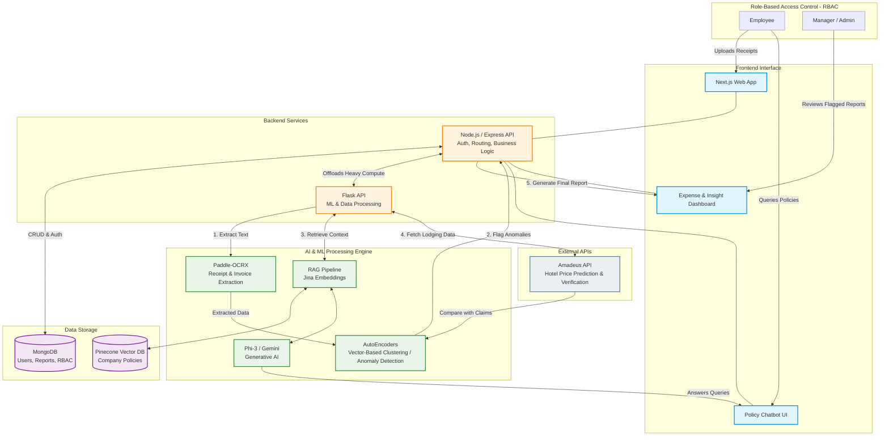

# 🚫💸 FRAUD ZERO 

**An AI-Powered Expense Report Generator with Fraud Detection**  
*Built by Team py.charmers*

---

## 📖 Project Overview

**Fraud Zero** is an intelligent, automated platform designed to streamline the generation of corporate expense reports while rigorously enforcing fraud detection and policy compliance. By leveraging state-of-the-art AI, Optical Character Recognition (OCR), and machine learning, this platform significantly reduces manual effort, prevents financial leaks, and provides actionable insights for enterprise financial optimization. 

Our system not only extracts data from invoices and receipts with high accuracy but also acts as an active compliance guard. Through advanced anomaly detection models and a dynamic policy chatbot, Fraud Zero ensures that every penny claimed aligns with company guidelines.

## 🎯 Why Do We Need Fraud Zero?

Traditional expense reporting is tedious, error-prone, and highly susceptible to fraudulent claims. Fraud Zero tackles these industry-wide challenges by:
*   **Eliminating Manual Errors & Reducing Processing Time:** Automating data entry straight from receipts.
*   **Preventing Expense Fraud & Detecting Anomalies:** Catching duplicate claims, unusual spending patterns, and inflated costs in real-time.
*   **Enhancing Compliance & Policy Adherence:** Empowering employees to understand policies via an AI chatbot before submitting expenses.
*   **Securing Sensitive Financial Data:** Ensuring that managers and employees only see what they are authorized to see.
*   **Providing Actionable Insights:** Generating comprehensive reports that help companies optimize their travel and operational budgets.

## ✨ Key Features

*   🤖 **Automated Expense Processing:** Eliminates manual data entry by extracting text directly from receipts and invoices using **PaddleOCRx**.
*   🕵️ **Advanced Fraud Detection:** Utilizes **AutoEncoders** and vector-based clustering to detect anomalies, flag suspicious transactions, and identify duplicate claims.
*   💬 **Intelligent Policy Assistant (RAG Chatbot):** A Retrieval-Augmented Generation chatbot powered by **Phi-3/Gemini** and **Pinecone/Jina** allows employees to dynamically query company expense policies, ensuring adherence to financial guidelines before submission.
*   🔐 **Role-Based Access Control (RBAC):** Secures access to expense reports and financial data based on organizational hierarchy (e.g., Employee, Manager, Admin).
*   🏨 **Smart Cost Prediction:** Integrates the **Amadeus API** to predict hotel expenditures, helping to identify the most economical lodging options and enforce cost efficiency.
*   📊 **Comprehensive Reporting:** Automatically compiles validated expenses into detailed reports, highlighting irregularities and providing actionable financial insights.

### 🏗️ System Architecture & Workflow

### 📝 Flowchart Breakdown (Textual Explanation)
You can add this text right below the diagram in your README to explain the data flow to readers:

**How the System Works (Data Flow):**
1. **Input & Extraction:** An employee uploads a receipt via the **Next.js** frontend. The **Node.js** backend routes this to the **Flask** server, where **Paddle-OCRX** accurately extracts the text and financial data from the document.
2. **Fraud & Anomaly Detection:** The extracted data is passed through an **AutoEncoder** machine learning model. Using vector-based clustering, it compares the current expense against historical spending patterns to instantly flag anomalies, duplicates, or suspicious behavior.
3. **Cost Optimization:** For travel expenses, the system pings the **Amadeus API** to predict and verify hotel expenditures, ensuring the claimed amount aligns with economical lodging options.
4. **Policy Chatbot (RAG):** If an employee is unsure about an expense rule, they ask the chatbot. The query goes through a RAG pipeline (powered by **Phi-3/Gemini**), retrieves the exact company guidelines stored as vectors in **Pinecone/Jina**, and provides a dynamic, accurate answer.
5. **Secure Reporting:** The final, processed data is saved to **MongoDB**. Thanks to **Role-Based Access Control (RBAC)**, managers are presented with a secure, detailed dashboard highlighting any irregularities, flagged anomalies, and actionable insights for financial optimization.

## 🛠️ Technology Stack

Fraud Zero is built on a robust, scalable, and AI-centric technology stack:

### Frontend & Backend
*   **Frontend:** Next.js (React)
*   **Backend:** Node.js (Express), Python (Flask)
*   **Database:** MongoDB

### Artificial Intelligence & Machine Learning
*   **OCR Engine:** Paddle-OCRX (for high-accuracy receipt parsing)
*   **Large Language Models (LLMs):** Phi-3, Google Gemini
*   **Vector Database (RAG):** Pinecone, Jina
*   **Anomaly Detection:** AutoEncoders (for vector-based clustering of spending patterns)

### External Integrations
*   **APIs:** Amadeus API (for hotel booking and expenditure prediction)

---
*Run smarter expense tracking. Streamline your expense management with real-time collaboration, track receipts, generate reports, and manage budgets from anywhere with FRAUD ZERO.*
